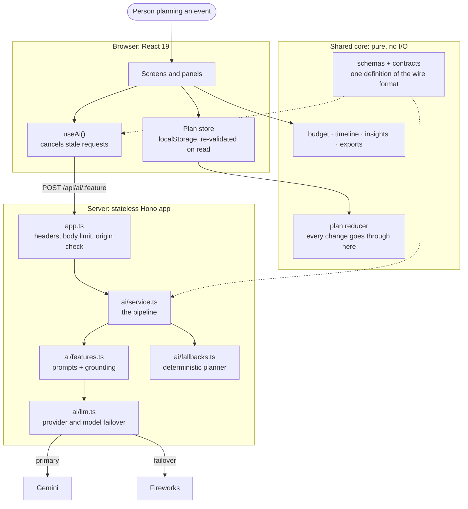
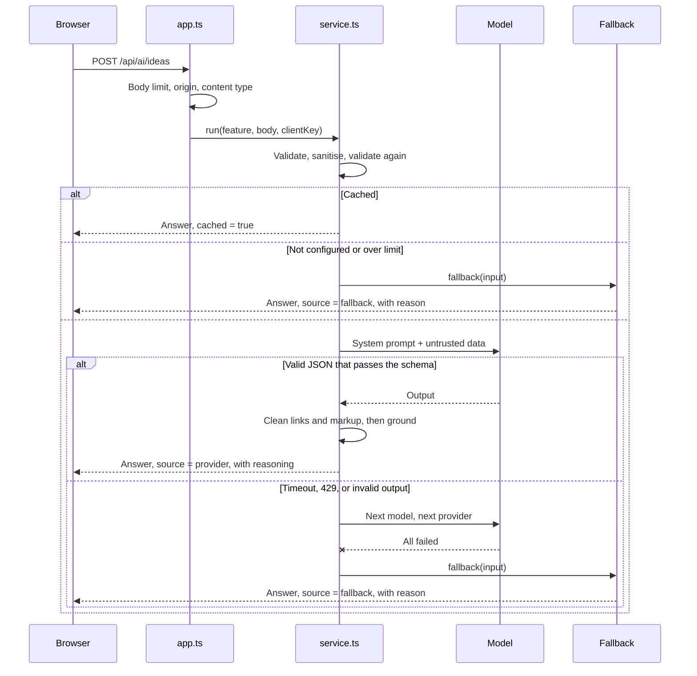

# Grace: architecture

## 1. The one-sentence version

A React client holds the plan and does all planning arithmetic locally, while a small stateless Hono server is the only thing that can talk to a model, and it validates, rate-limits, grounds and, when necessary, replaces whatever the model says.

## 2. System diagram

## 3. One AI request

## 4. Layering rules

| Layer  | Path          | Rule                                                                                             |
| ------ | ------------- | ------------------------------------------------------------------------------------------------ |
| Shared | `src/shared/` | Pure and isomorphic. No I/O, no clock, no framework. "Today" is always a parameter               |
| Server | `src/server/` | The only code that reads the environment or calls a provider. `fetch` and the clock are injected |
| Client | `src/client/` | Renders state and dispatches actions. Holds no business rules of its own                         |

These are enforced by `no-restricted-imports` in [`eslint.config.mjs`](eslint.config.mjs). CI fails if client code imports server code, which is the structural reason a key cannot reach the browser. A Playwright test also inspects the served bundle to confirm it.

## 5. Key decisions

### Deterministic core, AI on top

A plan is created instantly and completely by pure code, with the AI layering specifics over it. So a plan always exists, money always adds up, and an outage costs some personalisation rather than the product.

### One pipeline, one registry

Each AI feature is a single entry in `AI_FEATURES`: its prompt, its grounding and its fallback. Validation, sanitising, caching, limits, failover and logging are written once in `service.ts`. Adding an eighth feature cannot forget the rate limit, because a feature has no way to skip the pipeline.

### One contract, both directions

`shared/contracts.ts` defines the input and output of each feature with Zod. The server validates requests and model output against it, and the client validates responses against it, so types and runtime checks cannot drift apart.

### The AI proposes, the reducer disposes

The assistant cannot change anything. It returns proposals as data, the user approves each one, and it then goes through the same `planReducer` as a manual edit, which refuses impossible moves. This bounds what a confused or manipulated model can do, a risk known as excessive agency.

### Failover inside the parse step

`llm.complete(request, parse)` runs validation inside the retry chain. Output that fails the schema is treated like a 500, and the next model gets a chance before the offline planner does.

### Plans live in the browser

There is no account or database, which removes a whole class of risks (credential storage, breach of personal data, access control) and makes the server stateless. The trade-off is that plans do not sync, which is stated in the README.

## 6. Failover rules

| Situation                      | Behaviour                                                                       |
| ------------------------------ | ------------------------------------------------------------------------------- |
| 408, 429, 5xx, 404             | Try the next model on the same provider                                         |
| 400, 401, 403                  | Skip that provider's other models, which cannot help, and try the next provider |
| Timeout (12 s per attempt)     | Try the next model                                                              |
| Invalid JSON or schema failure | Try the next model                                                              |
| 25 s overall deadline          | Stop, and use the offline planner                                               |

404 is included because a retired model is a real, observed failure: during development `gemini-2.5-flash` answered 404 for new keys, while `gemini-3.8-flash` regularly exceeded 40 s. The default chain was chosen by measuring models on a free-tier key, and it can be changed through environment variables. Free-tier quota is about 15 requests per minute per model, so the fallback is deliberately a different model with its own quota. This was tested against the real API: the primary was exhausted until it answered 429, and the pipeline still returned live AI answers.

## 7. Efficiency

| Technique                           | Effect                                                                                |
| ----------------------------------- | ------------------------------------------------------------------------------------- |
| Route and panel code splitting      | 107.5 kB gzipped entry, with each panel about 2 kB on demand                          |
| CI bundle budget                    | `scripts/check-bundle-size.mjs` fails the build if the budget is exceeded             |
| Self-hosted fonts, no CSS framework | Fonts are served from the same origin and the CSS is 6.7 kB gzipped                   |
| LRU + TTL response cache            | A repeated request returns without calling a model                                    |
| In-flight request sharing           | A double click or a second tab shares one model call                                  |
| Request cancellation                | A superseded request is aborted rather than left to finish                            |
| Debounced storage writes            | Typing does not serialise every plan on each keystroke                                |
| Bounded data                        | Schemas cap every string and array, and only recent chat history is sent to the model |

## 8. Scaling

The server holds no session state, so it scales horizontally without coordination. The model provider becomes the bottleneck first, and the global limit keeps spend predictable. Beyond one instance, the rate limiter and cache should move to Redis, since both are per instance today.

## 9. Testing strategy

| Level       | Tools                  | What it covers                                                                                    |
| ----------- | ---------------------- | ------------------------------------------------------------------------------------------------- |
| Unit        | Vitest                 | Pure logic and edge cases (leap days, zero budgets, compressed schedules)                         |
| Property    | fast-check             | Invariants: allocation sums exactly, no task lands in the past, a CSV cell never starts a formula |
| Integration | Vitest + `app.request` | The real HTTP app, with only `fetch` stubbed, including failover and headers                      |
| Component   | Testing Library + axe  | Real interactions and an accessibility scan of each state                                         |
| Browser     | Playwright + axe       | The built server in Chromium: full journey, contrast in both themes, keyboard, phone width, CSP   |
| Tokens      | Vitest                 | WCAG contrast of every design-token pair in both themes                                           |

Nothing talks to a real model in automated tests, so runs are deterministic, free, and safe to run in CI without secrets.
